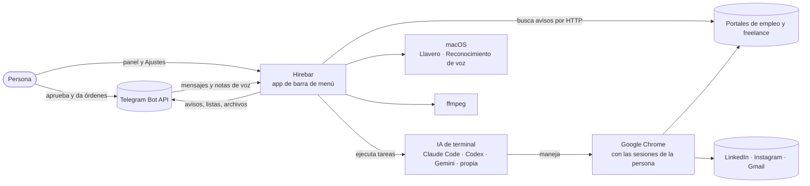
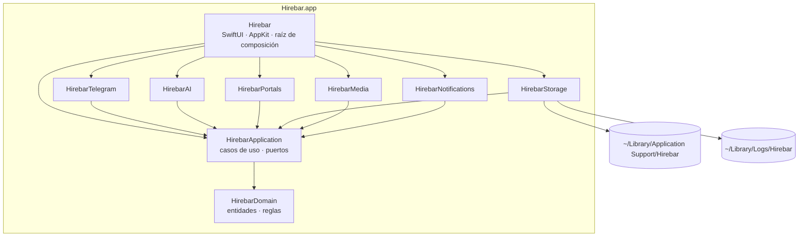

# ARCHITECTURE — Hirebar

`Draft` · Última actualización: 2026-11-05 · Responsable: cenhawer

Capa técnica transversal del proyecto. Se referencia en cada spec y no se re-decide por feature. Una
divergencia entre este documento y el código es un hallazgo; las que existen hoy están en la
columna "Estado actual" y se cierran con las specs de `docs/Plan.md`.

---

## 1. Contexto y alcance

Hirebar es una app de barra de menú para macOS que trabaja por una persona que busca empleo remoto,
proyectos freelance y clientes. Revisa portales, filtra con el perfil de la persona, le avisa por
Telegram y, con su aprobación, usa una IA de terminal que maneja su Chrome para postular, proponer,
escribir correos y preparar publicaciones.

**Fuera de alcance:**

- Resolver CAPTCHAs, escribir contraseñas o crear cuentas.
- Servidor propio, backend en la nube o cuentas de Hirebar: todo corre en la Mac de la persona.
- Varios usuarios por instalación: una instalación atiende a una persona y a un chat de Telegram.
- Publicar o enviar sin aprobación, salvo el envío automático que la persona prende por agente.

**Restricciones:**

| Restricción | Valor |
|---|---|
| Plataforma | macOS 26 o superior, Apple Silicon |
| Lenguaje y build | Swift 6 con concurrencia estricta, SwiftPM sin paquetes externos |
| Equipo | Un responsable (cenhawer) y el autor original (Víctor Mosquera) |
| Escala | Una persona; decenas de avisos por hora; una ejecución de IA a la vez |
| Prerrequisitos de sistema | IA de terminal con sesión iniciada, Google Chrome con la extensión de la IA, ffmpeg, bot de Telegram; permisos de Reconocimiento de voz y de notificaciones |

## 2. Estilo arquitectónico

**Hexagonal (puertos y adaptadores)**, con los límites impuestos por los targets de SwiftPM.

Por qué, contra los constraints reales:

- Hirebar integra muchas cosas externas que cambian solas: siete portales con HTML propio, cuatro
  motores de IA, la API de Telegram, Chrome, el reconocimiento de voz y ffmpeg. Cada una tiene que
  poder cambiar sin tocar las reglas.
- Las reglas importantes (qué aviso encaja, qué se aprueba, qué se envía) tienen que probarse sin
  red, sin IA y sin Chrome (constitución, principio VII).
- La separación entre leer contenido externo y actuar (principio III) es natural cuando cada una es
  un caso de uso con sus propios puertos.
- Un equipo de una o dos personas necesita que el compilador vigile los límites: un import que cruza
  una capa no compila.

### Diagrama de contexto (C4 nivel 1)

### Diagrama de contenedores (C4 nivel 2)

## 3. Módulos y límites

| Módulo (target) | Responsabilidad | Depende de | Expuesto vía |
|---|---|---|---|
| `HirebarDomain` | Entidades y reglas puras: agentes y tareas, perfil y habilidades, avisos y su encaje, lotes, cupos, cuentas de contenido, portales propios, clasificación de avisos, alineación del guion con la voz | Librería estándar | Tipos públicos |
| `HirebarApplication` | Casos de uso y puertos (sección 3.1) | `HirebarDomain` | Casos de uso; protocolos de los puertos |
| `HirebarTelegram` | Recibir mensajes, botones y notas de voz; traducir comandos a casos de uso; enviar textos, fotos, video y documentos | `HirebarApplication` | `Messenger`, `CommandSource` |
| `HirebarAI` | Lanzar el motor elegido con sus argumentos y variables `HIREBAR_*`; detectar sesión vencida | `HirebarApplication` | `AIRunner` |
| `HirebarPortals` | Un adaptador por portal incluido y el cliente HTTP | `HirebarApplication` | `PortalSource`, `WebPageFetcher` |
| `HirebarStorage` | Archivos del workspace con `schemaVersion` y migraciones, Llavero, registro | `HirebarApplication` | Repositorios, `SecretStore`, `Logger` |
| `HirebarMedia` | Render de carrusel, video y hojas de vida; preparar la voz con ffmpeg; reconocimiento de voz | `HirebarApplication` | `MediaRenderer`, `AudioProcessor`, `SpeechRecognizer` |
| `HirebarNotifications` | Notificaciones de macOS cuando Telegram no está configurado o falla; abren el panel | `HirebarApplication` | `Messenger` |
| `Hirebar` | Panel, menú, Ajustes; raíz de composición: instancia adaptadores, los conecta a los puertos y arranca | Todos | Ejecutable |

**Reglas de dependencia:**

- Las dependencias apuntan siempre hacia el dominio: adaptadores → Application → Domain.
- Un adaptador no importa otro adaptador. Si dos necesitan colaborar, lo hacen a través de un caso de
  uso.
- Solo la raíz de composición crea instancias de adaptadores. No hay singletons (`.shared`) fuera
  de ella.
- `HirebarDomain` no importa Foundation salvo los tipos de valor que no hacen E/S (`Date`, `URL`,
  `Data`, `UUID`); nunca `FileManager`, `Process`, `URLSession` ni `UserDefaults`.

### 3.1 Puertos

| Puerto | Dirección | Para qué | Adaptador |
|---|---|---|---|
| `CommandSource` | Entrada | Órdenes, aprobaciones y notas de voz de la persona | `HirebarTelegram` |
| `Messenger` | Salida | Avisos, listas con botones, fotos, video, documentos | `HirebarTelegram`; respaldo `HirebarNotifications` |
| `AIRunner` | Salida | Ejecutar una tarea con instrucciones, pedido y perfil (`read`, `draft` o `act`); devolver respuesta o fallo tipado | `HirebarAI` |
| `PortalSource` | Salida | Buscar avisos en un portal incluido | `HirebarPortals` |
| `WebPageFetcher` | Salida | Leer la página de un aviso | `HirebarPortals` |
| `MediaRenderer` | Salida | Carrusel, video corto y hojas de vida en PDF | `HirebarMedia` |
| `AudioProcessor` | Salida | Preparar la nota de voz y detectar pausas | `HirebarMedia` |
| `SpeechRecognizer` | Salida | Tiempos de cada palabra de la voz | `HirebarMedia` |
| Repositorios | Salida | Config, agentes, perfil, lotes, portales, cuentas, vistos, métricas | `HirebarStorage` |
| `SecretStore` | Salida | Token de Telegram y claves | `HirebarStorage` |
| `Clock` | Salida | Hora actual y temporizadores | `Hirebar` (raíz) |
| `Log` | Salida | Registro sin datos personales, sobre `os.Logger` | `HirebarApplication` (sin E/S propia) |

### 3.1.1 Perfiles de ejecución de la IA

Cada ejecución lleva un perfil. Los perfiles de cada motor viven en `Resources/perfiles-ia.json`, y
las reglas para comparar destinos (parámetros de seguimiento que se ignoran) en
`Resources/destinos.json`; los dos van dentro del bundle de la app, fuera del alcance de la IA.

| Perfil | Puede | No puede | Tareas |
|---|---|---|---|
| `read` | Leer archivos de la carpeta de trabajo, buscar en la web, ver páginas en Chrome | Escribir archivos, descargar direcciones con `WebFetch`, hacer clic, escribir en formularios, ejecutar código, enviar | Redes, portales propios |
| `draft(rutas)` | Lo de `read`, más escribir solo en las rutas declaradas | Lo demás de `read` | Clientes, seguimientos, contenido, perfil, análisis |
| `act` | Leer, escribir en la carpeta de trabajo y usar Chrome para actuar | Escribir fuera de la carpeta de trabajo | Postular, enviar propuestas, seguimientos, correos, publicar |

Las tareas `read` y `draft` que proponen envíos devuelven sus propuestas en el bloque
`HIREBAR_PROPOSALS_BEGIN` … `HIREBAR_PROPOSALS_END` de su salida (esquema en
`specs/010-separar-lectura-ejecucion/contracts/propuestas.schema.json`). Las ejecuciones `act` dejan
`workspace/ejecuciones/<lote>.acciones.json` (esquema en `contracts/registro-acciones.schema.json`), y la
app verifica cada acción contra la copia de lo aprobado. Toda lista para aprobar se arma desde la copia
que la app guarda al mostrarla, con destino y texto completos, también los correos de prospección:
la ejecución nunca relee un archivo que escribió la IA para decidir qué enviar. La fase `act` no puede
cambiar las reglas ni el perfil: Claude Code tiene negada la escritura sobre esas rutas y, con
cualquier motor, la app restaura al terminar lo que haya cambiado. Codex y Gemini CLI no tienen perfil `read`
con navegador: las tareas que leen con Chrome solo corren con Claude Code.

### 3.2 Casos de uso

| Caso de uso | Agente | Puertos |
|---|---|---|
| Revisar portales incluidos | Empleo, Freelance | `PortalSource`, `WebPageFetcher`, repositorios, `Messenger` |
| Revisar portales propios | Empleo, Freelance | `AIRunner` (solo lectura), repositorios, `Messenger` |
| Aprobar o descartar un lote | Todos los que envían | Repositorios, `Messenger` |
| Ejecutar un lote aprobado | Empleo, Freelance, Clientes, Contenido | `AIRunner` (con acciones), repositorios, `Messenger` |
| Hacer seguimientos | Freelance | `AIRunner`, repositorios |
| Buscar clientes y preparar correos | Clientes | `AIRunner` (solo lectura), repositorios, `Messenger` |
| Preparar publicación y video | Contenido | `AIRunner`, `MediaRenderer`, `Messenger` |
| Narrar el video con la nota de voz | Contenido | `AudioProcessor`, `SpeechRecognizer`, `MediaRenderer`, `Messenger` |
| Actualizar perfil y regenerar hojas de vida | Perfil | `AIRunner`, `MediaRenderer`, repositorios |
| Armar el análisis semanal | Analista | `AIRunner`, repositorios |
| Programar tareas por agente | Todos | `Clock`, repositorios |
| Verificar prerrequisitos | — | `AIRunner`, `AudioProcessor`, `SpeechRecognizer` |
| Mantener datos (retención y limpieza) | — | Repositorios, `Clock` |

### 3.3 Estado actual y destino de cada archivo

Dominio, aplicación y adaptadores ya son targets propios (`HirebarStorage`, `HirebarTelegram`,
`HirebarNotifications`, `HirebarPortals`, `HirebarMedia`, `HirebarAI`). `HirebarEngine` reúne los
casos de uso de lotes, comandos, programación y radares; `Engine` es la raíz de composición del motor
(crea Telegram con su almacén de secretos, el `Controller`, los radares y el programador, y los
conecta) y la app recibe esa instancia. No hay singletons propios (test). Los casos de uso leen y escriben datos solo a
través de los puertos de repositorio de `HirebarApplication`, agrupados en `Repositories`; la raíz
de composición pasa las implementaciones de archivos de `HirebarStorage` (`Repositories.files`). El paso 3 de la spec
`017-arquitectura-hexagonal` pasa esos casos de uso a `HirebarApplication` con puertos.

| Archivo actual | Destino | Nota |
|---|---|---|
| `HirebarDomain/Profile.swift` · `HirebarStorage/ProfileStore.swift` | Domain · Storage | Entidades en el dominio; lectura, `ProfileEditor` y `loadEffective` en el almacén |
| `HirebarDomain/SearchProfile.swift` · `HirebarStorage/SearchProfileStore.swift` | Domain · Storage | Las listas de palabras pasan a datos (spec `024`) |
| `HirebarDomain/ContentAccounts.swift` · `HirebarStorage/ContentAccountStore.swift` | Domain · Storage | Entidades en el dominio; carpetas, archivos y `ContentAccountStore` en el almacén |
| `HirebarDomain/Portals.swift` · `HirebarStorage/PortalStore.swift` | Domain · Storage | `CustomPortal` en el dominio; `PortalStore` en el almacén |
| `HirebarDomain/PlatformQuota.swift` · `HirebarStorage/Quotas.swift` | Domain · Storage | Cupo en el dominio; conteo persistido en el almacén |
| `HirebarApplication/AIEngine.swift` · `HirebarAI/AIEngineEnvironment.swift` | Application · AI | Elección del motor y comandos en la aplicación; variables `HIREBAR_*` en el adaptador |
| `HirebarDomain/TextTools.swift`, `Models.swift`, `Agents.swift` · `HirebarStorage/AgentStore.swift` | Domain · Storage | Normalización, lotes, agentes y tareas en el dominio; `AgentStore` y la búsqueda por nombre en el almacén |
| `HirebarStorage/WeeklyStats.swift`, `Metrics.swift` | Application + Storage | Cálculo como caso de uso; archivos de métricas a un repositorio |
| `HirebarApplication/Paths.swift` · `HirebarStorage/Config.swift`, `BatchStore.swift`, `Paths.swift`, `Housekeeping.swift` | Application · Storage | `Housekeeping` usa la retención del caso de uso de mantenimiento |
| `HirebarStorage/Keychain.swift` | Storage | `KeychainSecretStore` con `Security.framework`, puerto `SecretStore` |
| `HirebarApplication/Log.swift` · `Hirebar/LogExport.swift` | Application · Hirebar | `os.Logger` por área y por agente; el botón "Registro" exporta los últimos días |
| `HirebarTelegram/Telegram.swift`, `TelegramHTTP.swift` · `HirebarNotifications/MacNotifications.swift` · `HirebarEngine/Notifier.swift` | Telegram · Notifications · Application | `Messenger` y `CommandSource`; `Notifier` elige el canal y pasa a caso de uso en el paso 3 |
| `HirebarPortals/Net.swift` | Portals | `WebPageFetcher` |
| `HirebarAI/Shell.swift` | AI | Lanzamiento de procesos |
| `HirebarDomain/JobScreener.swift`, `FreelanceClassifier.swift` | Domain | Reglas de encaje |
| `HirebarPortals/ListingSource.swift` | Application + Portals | Protocolos a `PortalSource`; `Catalog` a la raíz de composición; `PageSlice` al adaptador |
| `HirebarPortals/*Source.swift` (7) | Portals | Un adaptador por portal |
| `HirebarEngine/Controller.swift` | Application | Se parte en los casos de uso de lotes |
| `HirebarApplication/CommandParser.swift` · `HirebarEngine/Commands.swift` | Application · Telegram | El parser puro lee el vocabulario de `Resources/comandos.json`; las acciones pasan a casos de uso en la spec `017` |
| `HirebarEngine/Scheduler.swift` | Application | Programar tareas, con `Clock` |
| `HirebarEngine/Radar.swift`, `JobRadar.swift`, `FreelanceRadar.swift` | Application | Revisar portales incluidos |
| `HirebarEngine/AgentPrompts.swift`, `ProfileRequests.swift` | Application | Armado del pedido para `AIRunner` |
| `HirebarAI/EngineCheck.swift` | AI | Probar el motor elegido |
| `HirebarEngine/AI.swift` · `HirebarAI/ClaudeCLI.swift`, `EngineProfiles.swift`, `ProtectedFiles.swift` | Application · AI | `AIRunner`: argumentos por perfil, comandos de Codex y Gemini, archivos protegidos |
| `HirebarMedia/ReelRenderer.swift`, `SlideRenderer.swift`, `CVRenderer.swift`, `WebFrameCapture.swift` | Media | `MediaRenderer` |
| `HirebarMedia/AudioTools.swift`, `SystemTools.swift` | Media | `AudioProcessor`, con el ffmpeg del sistema y los límites de `Resources/herramientas.json` |
| `HirebarMedia/VoiceListener.swift` · `HirebarDomain/ScriptAligner.swift` | Media · Domain | `VoiceListener` a `SpeechRecognizer`; alineación de la voz en el dominio |
| `HirebarEngine/Engine.swift` | Hirebar | Arranque en la raíz de composición |
| `Hirebar/*` (8) | Hirebar | Interfaz; `PanelModel` y `SettingsModel` pasan a `@Observable` (spec `018`) |

## 4. Contratos

### 4.1 API HTTP

Hirebar no expone una API HTTP. Consume:

| Servicio | Uso | Adaptador |
|---|---|---|
| Telegram Bot API | `getMe` (validar el token), `getUpdates` (long polling), `sendMessage`, `sendPhoto`, `sendVideo`, `sendDocument`, `editMessageReplyMarkup`, `answerCallbackQuery`, `getFile` | `HirebarTelegram` |
| Portales incluidos | Páginas de búsqueda y de cada aviso (LinkedIn, Get on Board, Computrabajo, elempleo, Magneto, Workana, Freelancer) | `HirebarPortals` |

### 4.2 Mensajería: comandos de Telegram

Contrato de entrada con la persona. Agregar, quitar o cambiar un comando se escribe aquí primero.

| Comando | Efecto |
|---|---|
| `si` · `si 1 3` · `no` (o los botones) | Aprueba toda la última lista, solo esos números, o la descarta |
| `estado` · `agentes` | Estado general y de cada agente |
| `buscar` · `buscar empleo` · `buscar freelance` | Revisa los portales ya |
| `seguimientos` · `informe` | Corre seguimientos o el análisis semanal ya |
| `anota <texto>` | Guarda una nota para el análisis |
| `corre <agente>` · `agente <agente> on/off` | Corre o prende/apaga un agente |
| `auto si/no` · `auto <agente> si/no` | Envío automático; prenderlo responde con la explicación y los botones "Sí, prender" (`autoon:<agentes>`) y "No" (`autocancel`) |
| `envia correos [números]` · `no correos` | Correos del día |
| `post [cuenta]` · `post <cuenta> cambia <qué>` · `post <cuenta> salta` · `publica [cuenta]` | Contenido |
| `video <cuenta>` · `rearmar <cuenta>` · nota de voz | Vista previa y guion; video narrado con la voz |
| `logro <texto>` · `trabajo <texto>` · `habilidad <nombre> <domino/conozco/evito>` · `habilidades` · `hv` | Perfil y hojas de vida |
| Responder citando un aviso | Elige a qué lista aplica la respuesta |
| `reanudar <agente>` · botones "Reanudar <agente>" y "Mantener en pausa" | Levanta o mantiene la pausa de un agente por una acción no autorizada |
| `practica` · `practica <agente> si/no` | Modo práctica: el agente hace todo menos enviar y cuenta lo que habría hecho |

El bot atiende solo a la cuenta anclada en Ajustes → Telegram y avisos (spec `012-canal-de-mensajes`,
ADR-0005); mensajes y botones de otras cuentas o de grupos se ignoran.

**Contrato con la IA de terminal** (motor propio y adaptadores):

| Variable | Contenido |
|---|---|
| `HIREBAR_PROMPT` | El pedido de esta ejecución |
| `HIREBAR_INSTRUCTIONS` | Ruta del archivo de reglas de la tarea (`instrucciones-*.md`) |
| `HIREBAR_FULL_PROMPT` | Reglas y pedido en un solo texto |
| `HIREBAR_WORKSPACE` | Carpeta de trabajo, que también es la carpeta actual |
| `HIREBAR_PHASE` | `read`, `draft` o `act`; "Otra IA" tiene un comando para lectura y otro para ejecución |

Lo que la IA imprime es la respuesta que llega a Telegram; `SIN_NOVEDADES` indica que no hubo nada
que reportar.

**Variables de entorno de la app y del build:**

| Variable | Uso |
|---|---|
| `HIREBAR_HOME` | Carpeta de datos alternativa (por defecto `~/Library/Application Support/Hirebar`) |
| `HIREBAR_BUILD_PATH` | Carpeta de compilación de `bundle.sh` y `coverage.sh` |
| `HIREBAR_SIGN_IDENTITY` | Identidad de firma de `bundle.sh` |

### 4.3 Datos

Archivos JSON y Markdown en `~/Library/Application Support/Hirebar/`, propiedad de la persona. Solo
`HirebarStorage` los lee y escribe.

| Archivo | Contenido |
|---|---|
| `config.json` | Portales activos, motor de IA, nombre y dueño del canal de Telegram (ID de usuario, chat, nombre) |
| `workspace/perfil.json` · `perfil.md` | Perfil: única fuente de experiencia, habilidades y variantes de hoja de vida |
| `workspace/agentes/<agente>.json` | Horario, envío automático, frecuencia y cupo de cada agente |
| `workspace/search-profile.json` | Palabras de búsqueda y descartes de los portales incluidos |
| `workspace/portales.json` · `portales-hallazgos.json` | Portales propios y lo que se encontró en ellos |
| `workspace/lotes.json` | Listas pendientes, en curso, hechas o descartadas |
| `workspace/cupos.json` | Cupos diarios por plataforma |
| `workspace/metricas-claude.json` · `metricas-radar.json` | Métricas de ejecuciones y búsquedas |
| `workspace/instrucciones-*.md` | Reglas de cada tarea para la IA |
| `workspace/hv/plantilla.html` · `HV_*.pdf` | Plantilla y hojas de vida generadas |
| `workspace/postulaciones.md` · `historial-propuestas.md` · `informes/` · `ejecuciones/` · `prospeccion/` | Registros de lo enviado, análisis y salidas de cada ejecución |
| `workspace/contenido/cuentas.json` · `contenido/<cuenta>/` | Cuentas de contenido; borrador, láminas, guion, video, grabación y rendimiento |
| `workspace/ejecuciones/<lote>.acciones.json` | Registro de acciones de una ejecución `act` |
| `workspace/ejecuciones/<lote>.practica.json` | Lo que habría enviado un agente en modo práctica, en lugar de ejecutar |
| `estado/propuestas/<lote>.json` · `estado/aprobados/<lote>.json` · `estado/verificaciones/<lote>.json` | Copia de cada lista tal como se mostró, de lo aprobado (con su agente) y verificación de cada acción; fuera del workspace, donde la IA no escribe |
| `estado/pausas.json` · `estado/vistos.json` | Pausas de agentes y propuestas ya mostradas en los últimos 30 días |

**Estado actual:** los archivos no tienen `schemaVersion` y parte del estado vive en `UserDefaults`
(`telegram.offset`, `video.esperandoVoz`, `radar.seen`, `jobradar.seen` y las
marcas del programador). La spec `022-version-datos` lleva todo al workspace con versión, migración
y respaldo previo.

**Estrategia de migraciones:** cada repositorio conoce la versión que escribe; al leer una anterior,
respalda el archivo junto al original y migra paso a paso; nunca sobrescribe un campo que la persona
editó. Al primer arranque se copian las plantillas de `Resources/inicial/` sin pisar las existentes.

## 5. Modelo de error

| Tipo | Ejemplo | Qué ve la persona | Qué se registra |
|---|---|---|---|
| Prerrequisito faltante | IA no instalada, ffmpeg ausente, sin permiso de voz | Mensaje con el paso exacto para resolverlo, al configurar | Tipo de falta |
| Sesión vencida de la IA | `please run /login` | Aviso por Telegram con el comando para volver a entrar; la lista queda para reintentar con `si` | Motor y hora, como máximo una vez por hora |
| Fallo de una ejecución | La IA termina con error o pasa la hora máxima | Resumen corto en Telegram | Código de salida y las últimas líneas, sin datos personales |
| Portal no responde o cambió | HTML distinto | Nada si es puntual; aviso si se repite | Portal y tipo de fallo |
| Archivo de datos inválido | JSON mal formado | La app sigue con los valores anteriores y lo indica en Ajustes | Archivo y posición del error |

Cada puerto devuelve errores tipados de su dominio; la traducción a texto para la persona ocurre en
la interfaz y en `HirebarTelegram`, con textos del String Catalog. Cada ejecución de la IA lleva el
identificador de su lote, que aparece en el registro y en `workspace/ejecuciones/`.

## 6. Seguridad

| Tema | Regla | Estado actual |
|---|---|---|
| Identidad de la persona | El bot atiende a un solo ID de usuario de Telegram, en su chat privado, anclado desde Ajustes tras validar el token y confirmar el nombre; límite de mensajes por minuto en `Resources/canal.json` | Cumple: mensajes y botones de otras cuentas o de grupos se ignoran y se registran sin contenido |
| Canal de respaldo | Notificaciones de macOS, locales, que abren el panel | Cumple: sin Telegram, sin dueño o cuando un envío falla; ningún aviso sale a un servicio público |
| Secretos | Token de Telegram y claves en el Llavero; nunca en archivos ni en el registro | Cumple |
| Contenido externo | Es dato, nunca instrucción: la fase que lee no tiene herramientas para actuar | Cumple: perfiles `read` y `draft`; en lectura la IA no puede leer el perfil ni las hojas de vida. Riesgo residual de navegación documentado en `specs/010-separar-lectura-ejecucion/research.md` (R8) |
| Acciones de la IA | Lista cerrada de acciones validada por la app | Cumple: catálogo de acciones, copia de lo aprobado fuera del workspace, registro y verificación de cada ejecución; una acción que no coincide pausa el agente |
| Envío automático | Se prende por agente con confirmación explícita | Cumple: diálogo en la Mac y botón en Telegram; cada cambio queda en el registro con su origen |
| Herramientas | Sin descargas en ejecución sin versión fija y hash | Cumple: ffmpeg del sistema (Homebrew), validado en Ajustes y al recibir una nota de voz; audios con tamaño máximo |
| Repositorio | Sin datos personales ni secretos; gitleaks en CI y pre-commit | Cumple |

## 7. Observabilidad

- **Registro:** `OSLog` con subsistema `com.vmsoftware.hirebar` y una categoría por agente
  (`empleo`, `freelance`, `clientes`, `contenido`, `perfil`, `analista`) y por área (`telegram`, `ia`,
  `portales`, `medios`, `notificaciones`, `datos`, `sistema`). El botón "Registro" exporta los últimos
  3 días a `~/Library/Logs/Hirebar/hirebar.log` y lo abre; también se lee con
  `log show --predicate 'subsystem == "com.vmsoftware.hirebar"'`. Campos: agente, caso de uso, lote y
  resultado. Sin datos personales.
- **Métricas de negocio:** avisos vistos, descartados y propuestos; envíos aprobados y hechos;
  respuestas; por agente y por semana. Las muestra el panel y las usa el Analista.
- **Métricas técnicas:** duración de cada ejecución de la IA y de cada búsqueda, fallos por portal.
- **Salud:** el panel muestra si la IA está libre o trabajando, si Telegram está conectado y cuándo
  corre cada agente.

## 8. Resiliencia

| Mecanismo | Valor | Dueño |
|---|---|---|
| Una ejecución de IA a la vez | Cola única, porque todos los agentes comparten el mismo Chrome | Caso de uso de lotes |
| Tiempo máximo por ejecución | 1 hora; después se detiene y se reporta | Caso de uso de lotes |
| Recuperación al reiniciar | Los lotes que estaban en curso vuelven a pendientes | Caso de uso de lotes |
| Tareas atrasadas | Si la Mac dormía, la tarea corre al despertar dentro de su tolerancia | Programador |
| Avisos repetidos | No se repiten durante su ventana (14, 21 o 30 días según la fuente) | Revisar portales |
| Aviso de sesión vencida | Como máximo una vez por hora | `HirebarAI` |
| Fallo parcial de un portal | Las demás fuentes siguen; el portal se reintenta en la siguiente vuelta | Revisar portales |
| Fallo de Telegram | Los avisos quedan en los lotes, llega una notificación de macOS y se pueden pedir con `estado` al volver | `HirebarTelegram`, `HirebarNotifications` |

Los valores de esta tabla pasan a configuración (spec `024`).

## 9. Entornos y despliegue

- **Entorno único:** la Mac de la persona. `HIREBAR_HOME` permite una carpeta de datos aparte para
  pruebas.
- **Desarrollo:** compilación y pruebas en el worker (Swift 6.4) con `HIREBAR_BUILD_PATH` fuera de
  iCloud; la cobertura de referencia es la del CI.
- **CI:** GitHub Actions en `macos-26` con `conventions`, `quality` y `build`; `main` y `develop`
  protegidas.
- **Release:** un tag `v*` sobre `main` publica el zip en GitHub Releases. Versión en `VERSION`,
  cambios en `CHANGELOG.md`.
- **Instalación:** `scripts/bundle.sh --install` copia la app a `~/Applications`. La distribución a
  personas que no compilan exige Developer ID y notarización (spec `032`).
- **Cierre ordenado:** al salir, la ejecución en curso se detiene y su lote vuelve a pendiente.
  Estado actual: la app termina sin detenerla y recupera los lotes interrumpidos al volver a abrir.

## 10. Decisiones (ADRs)

| ADR | Título | Estado | Fecha |
|---|---|---|---|
| [ADR-0001](docs/adr/0001-desarrollo-guiado-por-specs.md) | Desarrollo guiado por specs con Spec Kit | Aceptado | 2026-11-05 |
| [ADR-0002](docs/adr/0002-arquitectura-hexagonal.md) | Arquitectura hexagonal con límites por targets de SwiftPM | Aceptado | 2026-11-05 |
| [ADR-0003](docs/adr/0003-ffmpeg-prerrequisito-del-sistema.md) | ffmpeg como prerrequisito del sistema | Aceptado | 2026-11-05 |
| [ADR-0004](docs/adr/0004-macos-26-y-swift-6.md) | macOS 26 y Swift 6 como base | Aceptado | 2026-11-05 |
| [ADR-0005](docs/adr/0005-anclar-el-bot-por-id-de-usuario.md) | Anclar el bot por ID de usuario | Aceptado | 2026-11-09 |

Índice y plantilla en `docs/adr/README.md`.

## 11. Trade-offs asumidos y cuándo revisar

| Trade-off | Se acepta porque | Revisar si |
|---|---|---|
| Una ejecución de IA a la vez | Un solo Chrome con las sesiones de la persona | La cola de espera supera la tolerancia de las tareas |
| La IA maneja el navegador en vez de APIs oficiales | Los portales no tienen API para postular | Un portal publica una API de postulación o bloquea la automatización |
| Prerrequisitos del sistema en vez de empaquetarlos | Hoy todos los usuarios compilan con Xcode | Hirebar se distribuye a personas que no compilan (ADR en la fase 7) |
| Archivos en vez de base de datos | Una persona, volumen bajo, datos editables a mano | Las consultas del Analista o del historial se vuelven lentas |
| Telegram como único canal para aprobar desde el celular | Es donde la persona ya está; las notificaciones de macOS solo avisan y llevan al panel | Se agrega otro canal: entra como otro adaptador de `CommandSource` y `Messenger` |
| macOS 26 como mínimo | APIs actuales de SwiftUI, `@Observable` y Liquid Glass | `xcode-27` es estable en GitHub Actions: subir a macOS 27 |
